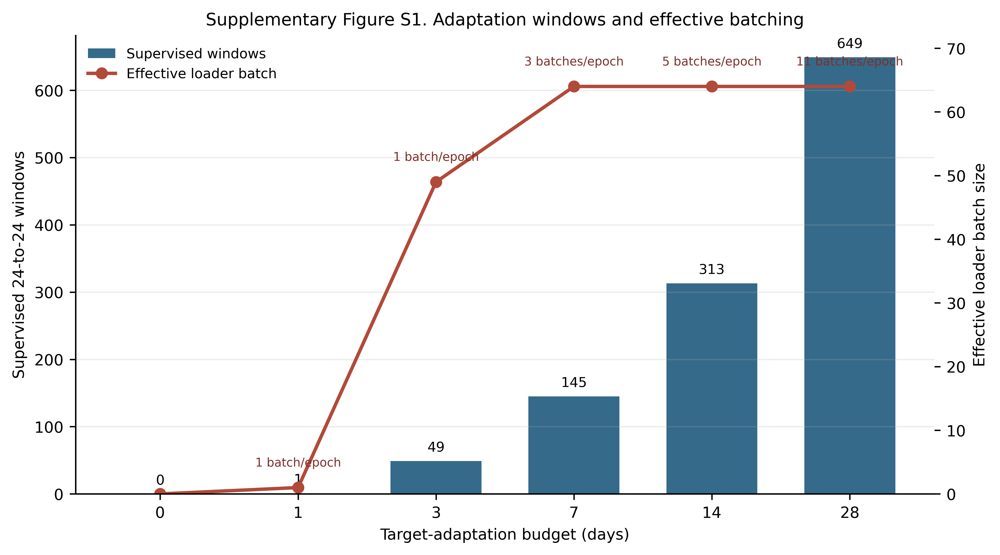
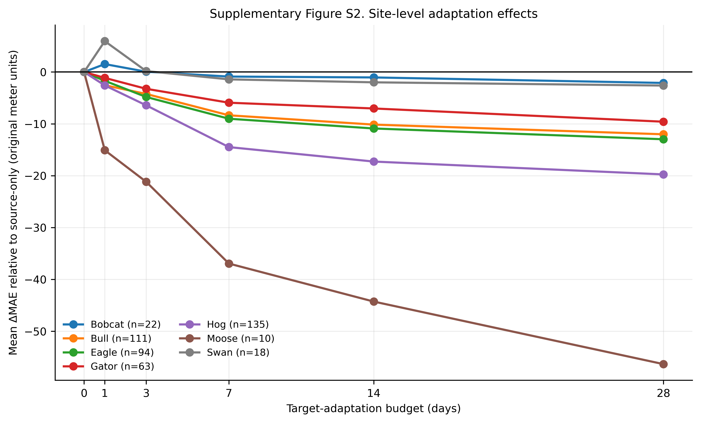
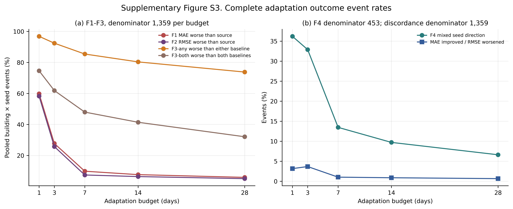
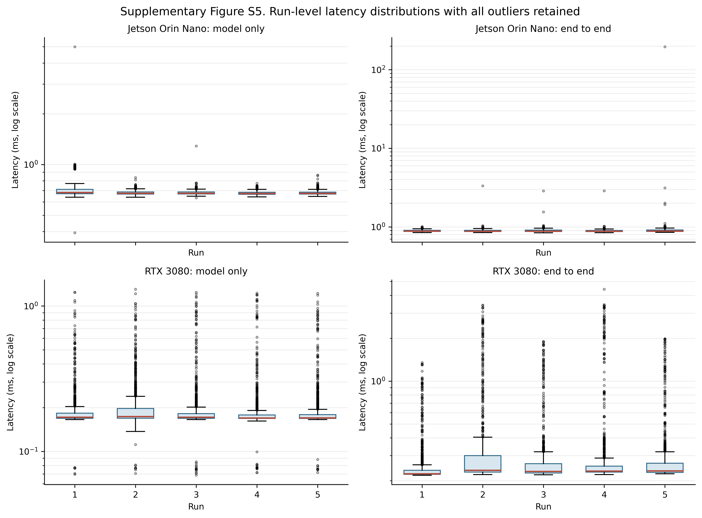
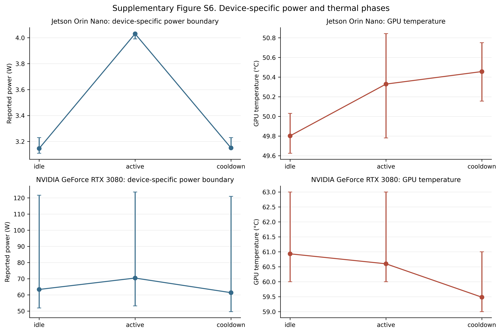
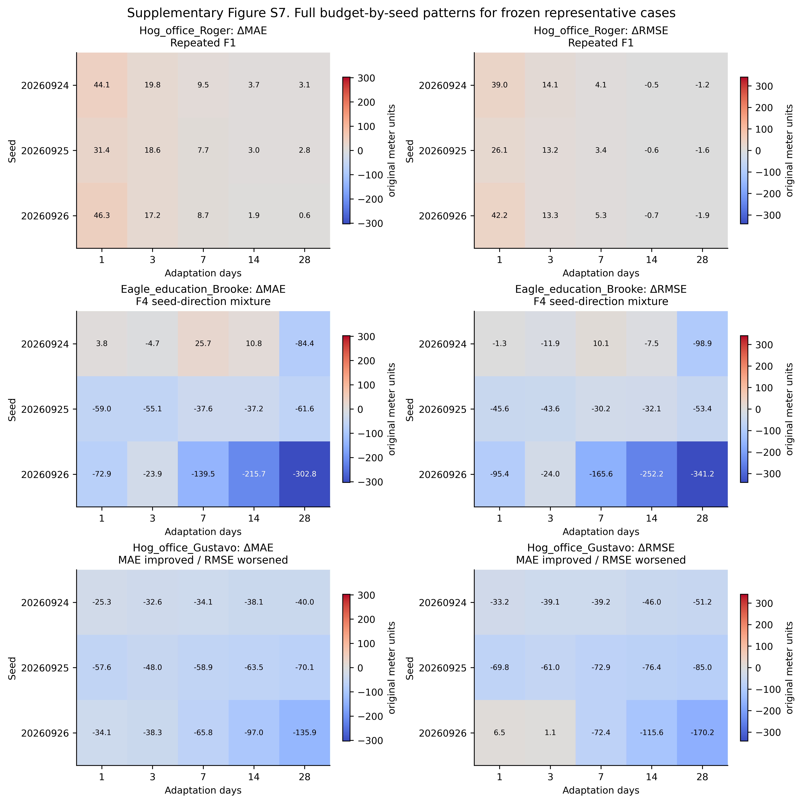

# Supplementary Materials

## Data-Efficient Cross-Building Transfer Learning for 24-Hour Electricity Forecasting

These materials document the complete frozen C0 LSTM final evaluation, failure analysis, exploratory building-characteristic analysis, and FP32 edge validation. They add reproducibility details and complete filterable result tables without altering the main-text results. No model was trained, adapted, or rerun to assemble this Supplementary package.

# Supplementary Methods

## Methods S1 Scope and frozen evidence

The final evaluation used the frozen `final_test_proposal` site allocation, the Gate 0 quality rule, the Gate 1 temporal constructor, the three source checkpoints for seeds 20260924-20260926, and the Gate 2 C0 LSTM execution. The authoritative raw prediction table contains 6,088,320 rows with recorded SHA-256 `72732c5dc0b0ad9cb7440f326476cd8c2ae57dd9267f7e07398452ae5b636e43`. Gate 3 independently recalculated every metric; the maximum difference from execution-time metrics was 1.71×10^-13. This Supplementary assembly uses the preserved metric, event, characteristic, and edge files. It does not regenerate the raw predictions.

## Methods S2 Building eligibility and cohort construction

The proposed final cohort contained 510 buildings from nine sites. Eligibility required the previously frozen preliminary candidate condition, at least 90 days in the longest complete hourly run, numeric observations, values not entirely zero, and no continuous zero run of 30 days or longer. These rules retained all 453 eligible buildings from seven sites and excluded 57 buildings for `continuous_zero_run_ge_30d`. Mouse and Shrew had no retained building under the frozen rule. Building selection did not use model performance.

## Methods S3 Temporal boundaries and forecasting windows

For each retained building, the temporal constructor used the end of the longest verified complete hourly run to place one 24-hour initial-history block, a maximum 28-day adaptation-label block, and an independent 28-day test block. The same test timestamps were used for every budget and seed. A forecast origin denotes the first target hour. Each input contains the preceding 24 observed electricity values, and each target contains the next 24 hours beginning at the origin. All 48 timestamps are finite and one hour apart. The primary evaluation uses 28 origins separated by 24 hours, producing 672 nonoverlapping target hours per building-condition pair. Adaptation labels and test labels have an empty timestamp intersection. The zero-day condition uses no target-building training label.

## Methods S4 C0 inputs, normalization, and source model

Each 24 × 6 input pairs one source-normalized past electricity value with five deterministic features for the corresponding target hour: sine and cosine of hour of day, sine and cosine of weekday, and a weekend indicator. The calendar values are known at forecast creation. Future measured load and weather are not inputs. The frozen source mean is 167.0651976323119 and the population standard deviation is 354.328669571624. The model is a one-layer LSTM with 32 hidden units followed by a linear 24-output head, totaling 5,912 parameters. Source training used Adam at 0.001, mean MSE on normalized targets, a nominal batch of 256, a maximum of 100 epochs, patience 10, and minimum improvement 10^-5. All three completed source runs used batch 256 without OOM fallback. Training batches were shuffled and the final partial batch was retained.

## Methods S5 Target adaptation and actual batching

Adaptation reloads the source checkpoint, freezes every LSTM parameter, and passes only `model.head.parameters()` to Adam at 0.0005. It minimizes the same mean MSE on source-normalized targets for 50 epochs without early stopping. The candidate batch is 64, with OOM-only fallbacks of 32 and 16. The actual DataLoader rule is `min(candidate batch, number of adaptation samples)`, with shuffle enabled and `drop_last=False`. No OOM fallback occurred in the completed final run. The 1-, 3-, 7-, 14-, and 28-day budgets contain 1, 49, 145, 313, and 649 supervised windows, respectively. Consequently, the effective first-attempt loader batches are 1, 49, 64, 64, and 64. The retained final batches contain 17, 57, and 9 samples at 7, 14, and 28 days.

## Methods S6 Metrics, aggregation, bootstrap, and failure events

MAE and RMSE are calculated in original meter units over all 672 target hours. The previous-day baseline repeats the 24 input values. The weekly-same-hour baseline uses the corresponding observations 168 hours earlier when available; all frozen final windows had the required history. Site-equal summaries first average buildings within site and then average the seven sites. H1 uses the three-seed mean 28-day ΔMAE within building, equal building weights within site, and equal site weights. The percentile interval resamples sites 10,000 times with seed 20260925. H2 and H3 report effect sizes and the same site-cluster interval; no p-value or Holm procedure was performed.

With `EPS=10^-12`, F1 denotes adapted MAE worse than source-only, F2 denotes adapted RMSE worse than source-only, F3-PD and F3-W denote adapted MAE worse than the previous-day and weekly baselines, and F4 denotes mixed seed directions for ΔMAE within a building-budget pair. F1-F3 are building × budget × seed events with denominator 1,359 per budget. F4 is a building × budget event with denominator 453 per budget. MAE improvement combined with RMSE worsening is reported separately and is not a new failure category.

## Methods S7 Exploratory building characteristics

Exploratory features use only information available before the frozen test period. The zero-day condition has only the immediately preceding 24-hour context and does not assume access to 28 days of target history. Nonzero budgets use the permitted context and adaptation observations. Features include mean, population standard deviation, coefficient of variation, zero ratio, daily and weekly repeatability, load-scale differences from source references, source percentile, floor area, site, and primary use. Spearman associations are descriptive and are neither causal estimates nor selection rules. Undefined weekly repeatability correlations remain missing. After Gate 3, an addendum corrected grouping so that the 18 Swan buildings with missing `primaryspaceusage` remain under `<missing>`. Predictions, metrics, H1-H3, and F1-F4 were unchanged.

## Methods S8 Cross-device and edge procedures

E4 transferred the frozen seed-20260924 FP32 checkpoint to the Jetson Orin Nano and compared 64 × 24 = 1,536 outputs with RTX references. Acceptance required exact shape, zero NaN/Inf, normalized maximum/mean absolute differences no greater than 10^-4/2×10^-5, and physical-scale maximum/mean differences no greater than 0.05/0.01. E5 used batch 1 and two timing boundaries. Model-only timing used CUDA events with input already on device. End-to-end timing included CPU-memory-to-CUDA transfer, forward execution, output transfer to CPU memory, and synchronization; it excluded disk I/O, startup, and checkpoint loading. Each device and mode used 200 warm-ups and five runs of 1,000 observations. Outliers were retained. Jetson VDD_IN and RTX GPU board power use different physical boundaries and were not divided to claim comparative energy efficiency.

## Methods S9 Representative cases and reproducibility

The representative cases were chosen by frozen rules before plotting. `Hog_office_Roger` maximized repeated seed-mean F1 budgets, with deterministic ties. `Eagle_education_Brooke` had the largest F4 seed ΔMAE range. `Hog_office_Gustavo` had the largest RMSE worsening among events where MAE improved. The Figure 8 extraction selected 10 specified building-seed-budget combinations from the existing raw prediction table, yielding exactly 6,720 rows. Every combination contains 28 origins × 24 horizons, and source/adapted timestamps and observations match exactly. The extraction contains no NaN, Inf, or duplicate key.

# Supplementary Tables

## Table S1 Cohorts and final-site retention

**Panel A. Cohort roles.**

| cohort | purpose | buildings | sites |
|---|---|---|---|
| Source | Source pretraining/model selection | 20 | 4 |
| Development | Development adaptation and evaluation | 12 | 6 |
| Final proposed | Frozen final-test proposal before quality exclusion | 510 | 9 |
| Final retained | Independent final evaluation | 453 | 7 |

**Panel B. Proposed and retained final sites.**

| site_id | proposed_buildings | retained_buildings | excluded_buildings | retained_site |
|---|---|---|---|---|
| Bobcat | 23 | 22 | 1 | Yes |
| Bull | 122 | 111 | 11 | Yes |
| Eagle | 104 | 94 | 10 | Yes |
| Gator | 67 | 63 | 4 | Yes |
| Hog | 147 | 135 | 12 | Yes |
| Moose | 13 | 10 | 3 | Yes |
| Mouse | 7 | 0 | 7 | No |
| Shrew | 9 | 0 | 9 | No |
| Swan | 18 | 18 | 0 | Yes |

Source: Data S1 and the frozen multibuilding cohort manifest. Counts are buildings and distinct sites.

## Table S2 Exact training and adaptation configuration

The complete setting table is `tables/Table_S2_training_and_adaptation_configuration.csv`. Actual budget-specific batching is shown below.

| adaptation_days | supervised_windows | effective_loader_batch_size | batches_per_epoch | batch_sizes_per_epoch |
|---|---|---|---|---|
| 0 | 0 | 0 | 0 | none |
| 1 | 1 | 1 | 1 | 1 |
| 3 | 49 | 49 | 1 | 49 |
| 7 | 145 | 64 | 3 | 64,64,17 |
| 14 | 313 | 64 | 5 | 64,64,64,64,57 |
| 28 | 649 | 64 | 11 | 64x10,9 |

Source: final Stage-6 read-only code audit. The 64 value is a candidate maximum; it is not the actual batch for the 1- or 3-day budget.

## Table S3 Site-equal performance and baselines

| condition | adaptation_days | sites | mae_site_equal | rmse_site_equal | delta_mae_source_site_equal | delta_rmse_source_site_equal | a_rate_site_equal | b_rate_site_equal |
|---|---|---|---|---|---|---|---|---|
| C0_0d | 0 | 7 | 40.650004 | 54.659725 | 0 | 0 | 0 | 0.068196 |
| C0_1d | 1 | 7 | 38.423768 | 52.197642 | -2.226236 | -2.462084 | 0.396844 | 0.026676 |
| C0_3d | 3 | 7 | 34.986671 | 48.298499 | -5.663333 | -6.361227 | 0.692349 | 0.075611 |
| C0_7d | 7 | 7 | 29.647557 | 42.162266 | -11.002447 | -12.49746 | 0.898257 | 0.158691 |
| C0_14d | 14 | 7 | 27.413469 | 39.304352 | -13.236535 | -15.355373 | 0.919171 | 0.199327 |
| C0_28d | 28 | 7 | 24.167116 | 35.236382 | -16.482888 | -19.423343 | 0.948371 | 0.268486 |
| previous_day | — | 7 | 20.873993 | 39.524725 | — | — | — | — |
| weekly_same_hour | — | 7 | 18.1359 | 30.058154 | — | — | — | — |

Errors are in original meter units. A and B are site-equal rates on a 0-1 scale. The weekly baseline uses 168-hour history, whereas C0 neural inputs use 24 hours of measured electricity.

## Table S4 H1-H3 effect estimates

| hypothesis | estimand | estimate | ci95_lower | ci95_upper | status |
|---|---|---|---|---|---|
| H1 | site-equal MAE(28d) - MAE(source-only) | -16.482888 | -30.90757 | -6.562978 | supported by predefined criterion |
| H2 | site-equal F1 rate(28d) - F1 rate(1d) | -0.551527 | -0.679617 | -0.455237 | secondary effect-size analysis |
| H3 | site-equal A rate(28d) - B rate(28d) | 0.679885 | 0.58358 | 0.78354 | secondary effect-size analysis |

Intervals are 10,000-resample site-cluster percentile intervals with seed 20260925. H2 and H3 have no p-values or Holm-adjusted tests. The complete seven-site effects are in `tables/Table_S4_B_site_effects.csv`.

## Table S5 Complete failure-event counts

| adaptation_days | seed_event_denominator | f1_count | f2_count | f3_any_count | f3_both_count | building_budget_denominator_for_f4 | f4_count |
|---|---|---|---|---|---|---|---|
| 1 | 1359 | 813 | 792 | 1316 | 1014 | 453 | 164 |
| 3 | 1359 | 377 | 350 | 1256 | 841 | 453 | 149 |
| 7 | 1359 | 134 | 101 | 1161 | 652 | 453 | 61 |
| 14 | 1359 | 104 | 87 | 1092 | 563 | 453 | 44 |
| 28 | 1359 | 80 | 69 | 1003 | 436 | 453 | 30 |
| ALL_NONZERO | 6795 | 1508 | 1399 | 5828 | 3506 | 2265 | 448 |

F1-F3 denominators count building × seed events. F4 counts unique building × budget events. The `ALL_NONZERO` row aggregates the five nonzero budgets.

## Table S6 Exploratory association coverage

| response | records | valid | n_min | n_max | rho_min | rho_max |
|---|---|---|---|---|---|---|
| f1_seed_rate | 70 | 67 | 0 | 453 | -0.381837 | 0.26788 |
| f2_seed_rate | 70 | 67 | 0 | 453 | -0.320495 | 0.26905 |
| f3_any_seed_rate | 70 | 67 | 0 | 453 | -0.262995 | 0.180677 |
| seed_mean_mae_delta | 70 | 67 | 0 | 453 | -0.412772 | 0.318466 |
| seed_mean_rmse_delta | 70 | 67 | 0 | 453 | -0.362626 | 0.291795 |

The complete 350 records, including missing/undefined correlations and complete-case counts, are Data S8. All analyses are exploratory and descriptive.

## Table S7 E4 cross-device FP32 consistency

| scale | output_elements | max_abs_difference | max_abs_tolerance | mean_abs_difference | mean_abs_tolerance | rmse_difference | nan_count | inf_count | status |
|---|---|---|---|---|---|---|---|---|---|
| normalized | 1536 | 1.4782e-05 | 0.0001 | 1.49468e-06 | 2e-05 | 2.39524e-06 | 0 | 0 | PASS |
| physical | 1536 | 0.005238 | 0.05 | 0.00053 | 0.01 | 0.000849 | 0 | 0 | PASS |

The comparison comprises 1,536 output elements. Shape matched and NaN/Inf counts were zero.

## Table S8 E5 edge latency summary

| device | mode | count | mean_ms | median_ms | p95_ms | p99_ms | maximum_ms |
|---|---|---|---|---|---|---|---|
| Jetson Orin Nano | model_only | 5000 | 0.690587 | 0.675552 | 0.731138 | 0.960481 | 4.994784 |
| Jetson Orin Nano | end_to_end | 5000 | 0.932956 | 0.883082 | 0.937253 | 0.976195 | 195.884742 |
| RTX 3080 | model_only | 5000 | 0.205226 | 0.171072 | 0.354354 | 0.885665 | 1.303552 |
| RTX 3080 | end_to_end | 5000 | 0.33738 | 0.2326 | 0.91283 | 2.373438 | 4.413 |

All outliers are retained. The full 20,000 observations are Data S11. Memory and device-specific telemetry are in Table S8B-C and Data S12. RTX process RSS was unavailable because of the preserved collector error; no post-hoc probe was substituted.

## Table S9 Reproducibility hashes

The key artifact paths, sizes, hashes, and verification roles are provided in `tables/Table_S9_reproducibility_hashes.csv`. Three source checkpoint hashes are also provided as Data S17. The raw prediction hash is reported from the frozen artifact manifest and independently confirmed by the Figure 8 search audit.

## Table S10 Frozen Figure 8 cases

| case_type | building_id | seed | adaptation_days | mae | rmse | delta_mae | delta_rmse | row_count | validation_status |
|---|---|---|---|---|---|---|---|---|---|
| — | Hog_office_Roger | 20260926 | 0 | 14.809595 | 24.598941 | 0 | 0 | 672 | PASS |
| repeated_f1 | Hog_office_Roger | 20260926 | 1 | 61.098127 | 66.826992 | 46.288532 | 42.228051 | 672 | PASS |
| — | Eagle_education_Brooke | 20260924 | 0 | 187.584874 | 232.530755 | 0 | 0 | 672 | PASS |
| f4_seed_direction_mixed | Eagle_education_Brooke | 20260924 | 14 | 198.415448 | 225.051552 | 10.830575 | -7.479203 | 672 | PASS |
| — | Eagle_education_Brooke | 20260925 | 0 | 131.920074 | 167.801572 | 0 | 0 | 672 | PASS |
| f4_seed_direction_mixed | Eagle_education_Brooke | 20260925 | 14 | 94.681661 | 135.669833 | -37.238413 | -32.131739 | 672 | PASS |
| — | Eagle_education_Brooke | 20260926 | 0 | 388.389171 | 476.764106 | 0 | 0 | 672 | PASS |
| f4_seed_direction_mixed | Eagle_education_Brooke | 20260926 | 14 | 172.68675 | 224.591104 | -215.70242 | -252.173003 | 672 | PASS |
| — | Hog_office_Gustavo | 20260926 | 0 | 208.288076 | 266.737024 | 0 | 0 | 672 | PASS |
| mae_improved_rmse_worsened | Hog_office_Gustavo | 20260926 | 1 | 174.181016 | 273.221871 | -34.10706 | 6.484847 | 672 | PASS |

The Brooke 14-day ΔMAE range is 226.53299509003187, agreeing with the frozen selection value within floating-point precision. Gustavo seed 20260926 has ΔMAE -34.107059863317716 and ΔRMSE +6.484847373417267.

# Supplementary Figures

## Figure S1 Adaptation windows and effective batching

Bars show the actual supervised window count. The line shows the effective first-attempt DataLoader batch. Zero days has no adaptation loader. Source: Table S2B.

## Figure S2 Site-level adaptation effects

Each line is the building-equal, three-seed mean ΔMAE within one retained site. Negative values indicate improvement over source-only. The plot preserves all seven sites and all six budgets. Source: Data S5.

## Figure S3 Complete failure-event rates

Panel (a) uses 1,359 building × seed events per budget. In panel (b), F4 uses 453 building-budget events, whereas MAE-improved/RMSE-worsened discordance uses 1,359 seed events. Source: Table S5.

## Figure S4 Full exploratory association matrix

All 14 predefined continuous features, five responses, and five nonzero budgets are shown. Gray/white N/A cells are undefined because of insufficient complete cases and are not zero. No significance stars or causal claims are used. Source: Data S8.

## Figure S5 Run-level latency distributions

Each box summarizes 1,000 observations. All outliers are shown on a logarithmic latency axis. The Jetson end-to-end run-5 maximum of 195.884742 ms is retained. Source: Data S11.

## Figure S6 Device-specific power and thermal phases

Points are phase means and whiskers span observed minimum to maximum. Jetson power is the VDD_IN input rail; RTX power is GPU board power. The two panels must not be interpreted as equivalent measurement boundaries. Source: Data S12.

## Figure S7 Full budget-by-seed representative-case patterns

Cells show adapted-minus-source MAE or RMSE in original meter units for every nonzero budget and all three seeds in the three frozen representative buildings. This extends the main Figure 8 snapshots without reselecting cases. Source: Data S4 and the frozen representative-case record.

# Supplementary Data Availability and Known Gaps

Data S1-S17 are listed in `DATA_DICTIONARY.md`. All required final-evaluation, failure, exploratory, edge-latency, and Figure 8 evidence was available. Two edge measurements remain explicitly unavailable: RTX process RSS during the benchmark and the Jetson `jetson_clocks` state, which required interactive root access. TensorRT, ONNX, FP16, INT8, pruning, and quantization were not performed. Indoor temperature, humidity, and occupancy series were unavailable for the C0 final experiment. These absent measurements were not imputed or synthesized.
